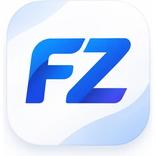
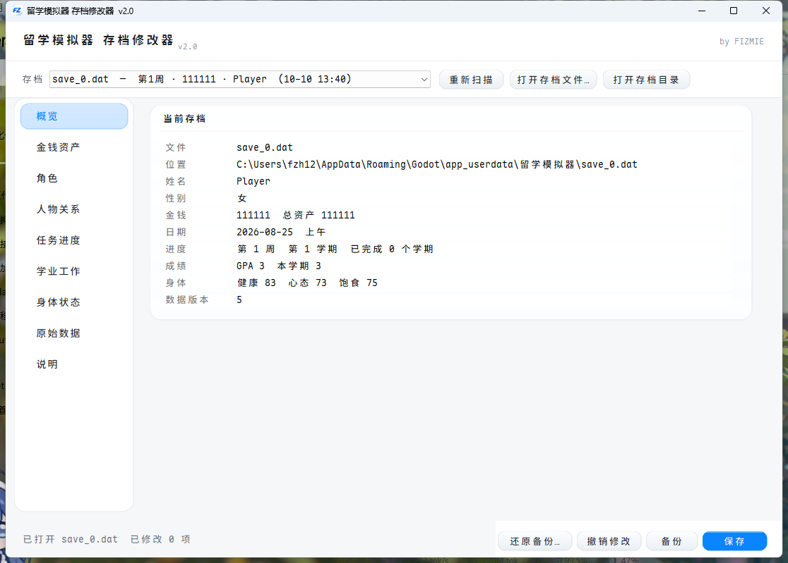
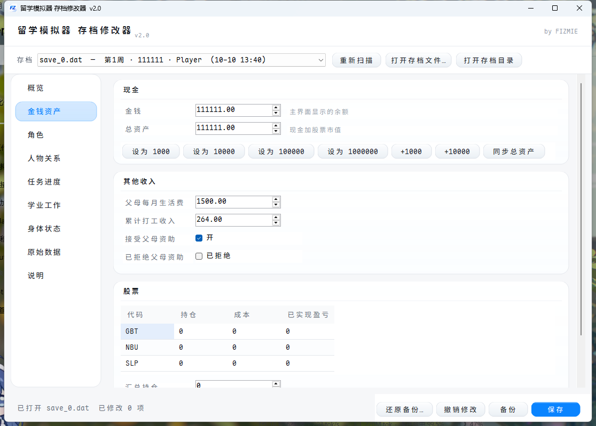
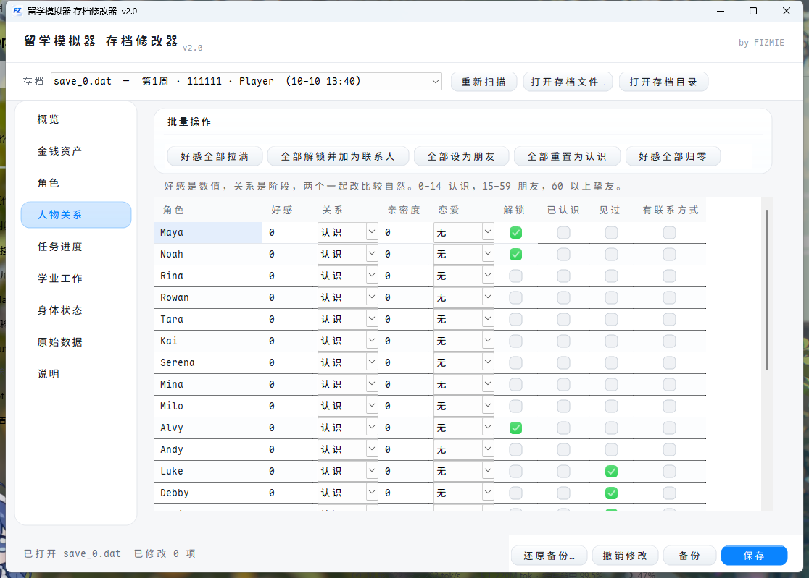
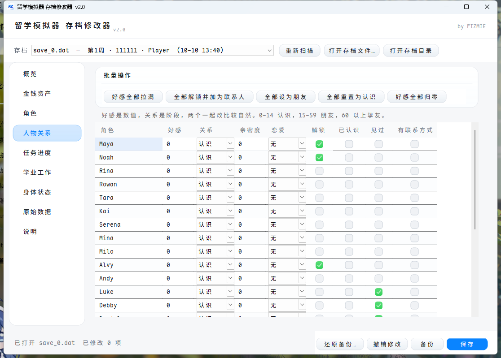
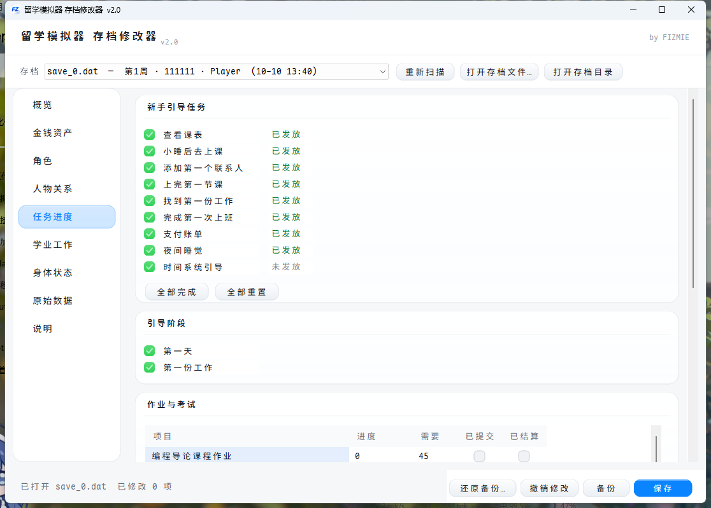

<p align="center">
  
</p>

# 留学模拟器 存档修改器

> 《留学模拟器》(Study Abroad Simulator) 的存档修改工具 · 原生 Windows 窗口 · 单文件绿色版

作者：**FIZMIE** · 版本：**2.0** · 协议：MIT



---

## 简介

一个用来修改《留学模拟器》存档的小工具。纯 C# / WinForms 手写界面，不依赖任何第三方库，只用 Windows 自带的 .NET Framework 编译器和运行库，编译出来就一个 80 KB 左右的 exe，双击即用，不需要安装。

不读内存、不注入进程、不碰游戏本体 —— **只改存档文件**，所以不会被反作弊/杀软针对游戏进程报警。

**界面**：字体用 [Maple Mono CN](https://github.com/subframe7536/maple-font)（含中文的等宽字体，SIL OFL 1.1），没装的话自动回落到微软雅黑，不会变成方块。圆角卡片、玻璃质感按钮、绿色打勾框全部是 GDI+ 自绘的，没有用系统默认控件外观。

---

## 下载

懒得自己编译的话，直接拿仓库里的 **[`留学模拟器修改器.exe`](留学模拟器修改器.exe)** —— 80 KB 单文件，双击就用。

- Windows 10 / 11 自带 .NET Framework 4.x，**不需要额外装任何运行库**
- 绿色免安装，不写注册表，删掉 exe 就等于卸载
- 如果 SmartScreen 弹「Windows 已保护你的电脑」，点 **更多信息 → 仍要运行**。所有没买数字签名的个人开发程序都会这样，不是病毒（想自己验证的话，源码就在 `src/` 里，`build.cmd` 一跑就能复现同一个 exe）

---

## 功能

按左侧导航分九页：

| 页面 | 能改什么 |
| --- | --- |
| **概览** | 存档摘要：姓名、性别、金钱、日期、进度、成绩、身体状态 |
| **金钱资产** | 现金、总资产、父母每月生活费、累计打工收入、股票持仓/成本/已实现盈亏 |
| **角色** | 玩家姓名、性别、专业、国家、目标线、人生模式 |
| **人物关系** | 每个 NPC 的好感、关系阶段、亲密度、恋爱阶段、解锁、已认识、见过、有无联系方式；带批量操作 |
| **任务进度** | 新手引导任务与阶段、作业与考试的进度/提交/结算 |
| **学业工作** | GPA、知识、声望、成长属性（魅力/情商/语言）、当前工作的各项工资与老板评价 |
| **身体状态** | 健康、心态、饱食、卡路里负担、声望 |
| **原始数据** | 直接看/改整个存档 JSON（带格式化与校验） |
| **说明** | 内置使用说明 |

**安全措施**

- 保存前自动把原文件复制到存档目录的 `备份/` 子文件夹（`save_0.dat.20261010-153000`）
- 「撤销修改」一键丢弃本次所有改动
- 「还原备份…」可回滚到任意历史备份，且还原前会再备份一次当前状态
- 保存时先写临时文件再原子替换，中途断电不会写出半个文件
- 写回时保持 UTF-8 无 BOM、缩进、键顺序，避免游戏读不动

---

## 截图

| 金钱资产 | 人物关系 |
| --- | --- |
|  |  |

| 任务进度 | 说明 |
| --- | --- |
|  |  |

---

## 使用方法

1. **完全退出游戏**（不是最小化，要真的退出；否则游戏退出时会把内存里的旧数据写回去，覆盖你的修改）
2. 双击 `留学模拟器修改器.exe`
3. 顶部下拉框会自动列出找到的存档，默认选最新的那个
4. 改你要改的数值
5. 点右下角 **保存**
6. 重新进游戏读档

> 找不到存档时，用「打开存档文件…」手动指定，或点「打开存档目录」看看游戏把存档放哪了。

---

## 存档格式解析

这部分是写这个工具时逆向出来的东西，想自己写脚本改存档的话可以直接参考。

### 文件位置

```
%APPDATA%\Godot\app_userdata\留学模拟器\
    save_0.dat     ← 存档（槽位 0）
    save_1.dat
    ...
    save_5.dat
    save_0.dat.bak ← 游戏自己留的上一份
```

游戏是 **Godot 4.6.2** 导出的（Steam AppID `4751090`），所以用 Godot 默认的 `user://` 路径，也就是 `%APPDATA%\Godot\app_userdata\<项目名>\`。

### 格式

**纯 JSON 文本**，不是二进制、不压缩、不加密。

- 编码 UTF-8，**文件开头没有 BOM**（有 BOM 游戏会解析失败）
- 顶层是一个对象，大约 60+ 个键
- 键按字母序排列
- 没有超过 2^53 的整数，所以用 double 存也不会丢精度

### ⚠️ 镜像字段（重点）

游戏把一部分数据**同时存了两份**，一份在顶层 `flags` 里，一份在 `state_modules` 里。**只改一份是不生效的**，游戏运行时会用另一份覆盖回来。

必须成对写入的字段：

| `flags` 下 | `state_modules` 下 |
| --- | --- |
| `flags.character_profiles` | `state_modules.characters` |
| `flags.goal_mode` | `state_modules.goal_mode` |
| `flags.social_clues` | `state_modules.phone_clues.social_clues` |
| `flags.social_post_reactions` | `state_modules.phone_clues.social_post_reactions` |
| `flags.encounter_state` | `state_modules.encounters` |

本工具的所有写入都会自动同步这两处。

### 主要字段

**基础**

| 字段 | 类型 | 说明 |
| --- | --- | --- |
| `cash` | number | 现金（主界面显示的余额） |
| `total_assets` | number | 总资产 = 现金 + 股票市值 |
| `health` / `mental` / `hunger` | number | 健康 / 心态 / 饱食 |
| `gpa` / `semester_gpa` | number | 总 GPA / 本学期 GPA |
| `reputation` | number | 声望 |
| `calorie_burden` | number | 卡路里负担 |
| `completed_semesters` | number | 已完成学期数 |
| `semester_week` | number | 当前是第几周 |
| `is_game_over` | bool | 是否已结局 |
| `save_schema_version` | number | 存档结构版本（当前为 5） |

**玩家（都在 `flags` 下）**

| 字段 | 取值 |
| --- | --- |
| `flags.player_name` | 字符串 |
| `flags.gender` | `male` \| `female` |
| `flags.major` | 专业 |
| `flags.intro_country` / `region` | 国家 / 地区 |
| `flags.life_mode_primary` | 人生模式 |
| `flags.orientation` | 性取向 |
| `flags.growth_axis.charm` / `.eq` / `.knowledge` / `.language` | 成长属性 |
| `flags.academic_knowledge` | 知识（和 `growth_axis.knowledge` 联动） |

**金钱相关（都在 `flags` 下）**

| 字段 | 说明 |
| --- | --- |
| `flags.parent_support_enabled` | 是否接受父母资助 |
| `flags.parent_support_monthly_amount` | 每月生活费 |
| `flags.parent_support_declined` | 是否已拒绝资助 |
| `flags.work_income_total_v1` | 累计打工收入 |
| `flags.stock_market.portfolio.holdings.<代码>` | 持股数 |
| `flags.stock_market.portfolio.avg_cost.<代码>` | 持仓成本 |
| `flags.stock_market.portfolio.realized_pnl.<代码>` | 已实现盈亏 |

**人物关系**

人物档案在 `state_modules.characters.profiles.<id>`（镜像到 `flags.character_profiles.profiles.<id>`）：

| 字段 | 类型 |
| --- | --- |
| `display_name` | 显示名 |
| `relationship` | 好感度（数值） |
| `unlocked` | 是否解锁 |

关系阶段在 `flags.person_relationship_progress.<id>`：

| 字段 | 取值 |
| --- | --- |
| `friendship_stage` | `acquaintance` \| `friend` \| `close_friend` |
| `intimacy` | 亲密度（数值） |
| `romance_stage` | `none` \| `flirting` \| `partner` |

另有几个散落的布尔字段：`flags.person_known_level_<id>`、`flags.person_seen_<id>`、`flags.person_contact_added_<id>`。

> 这个对象**不一定预先存在**。如果某个 NPC 还没建立过关系记录，直接往里写新键是安全的 —— 游戏会当成已经有进度。本工具用 `CommitEntry` 处理这种情况：既能在已有对象里改单个键，也能在对象不存在时按给定的模板新建。

**任务与学业**

| 字段 | 说明 |
| --- | --- |
| `flags.onboarding_tasks_rewarded` | 字符串数组，已完成的新手任务 id |
| `flags.onboarding_stages_rewarded` | 字符串数组，已完成的引导阶段 id |
| `flags.onboarding_latched` | 引导是否已锁定 |
| `academic_nodes` | 数组，作业/考试节点 |
| `academic_nodes[i].work_progress` | 进度 |
| `academic_nodes[i].required` | 需要的进度 |
| `academic_nodes[i].submitted` | 已提交 |
| `academic_nodes[i].resolved` | 已结算 |
| `academic_nodes[i].label_zh` / `.label` / `.id` | 名称 |
| `flags.job_storylines_v1` | 打工剧情线进度 |

**打工（`current_job`）**

`pay_per_action`、`base_pay_per_action`、`weekly_pay`、`weekly_hours`、`proficiency`、`boss_rating`、`absences`

**时间**

`day`、`month`、`year`、`day_slot`、`formal_calendar.current_date`、`flags.formal_calendar_week`、`full_game_foundation.run.semester_index`

### 一个容易踩的坑

Godot 4 的 `String` 在内存里是 **UTF-32LE**（不是 UTF-16）。如果你想写内存修改器，搜字符串要按 UTF-32 编；但改存档的话完全不用管这个，JSON 是文本。

---

## 编译

不需要 Visual Studio，也不需要联网 —— 只用 Windows 自带的 .NET Framework 编译器。

```bat
build.cmd
```

脚本会：

1. 用 `%WINDIR%\Microsoft.NET\Framework64\v4.0.30319\csc.exe` 编译窗口版
2. 顺便编译一份自测程序 `selftest.exe`
3. 把输出改名成 `留学模拟器修改器.exe`

也可以手动编译：

```bat
csc /target:winexe /platform:x64 /optimize+ ^
    /r:System.dll /r:System.Web.Extensions.dll /r:System.Windows.Forms.dll /r:System.Drawing.dll ^
    /win32icon:src\app.ico ^
    /out:留学模拟器修改器.exe ^
    src\SaveEditorForm.cs src\SaveDoc.cs src\Theme.cs src\GridStyle.cs
```

> `build.cmd` 必须是纯 ASCII。cmd.exe 按 OEM 代码页解析 `.cmd`，里面写中文会被解码成 `&`、`|` 之类的字符然后当成命令执行。中文文件名是用 `[char]0x...` 转义拼出来的。

### 跑自测

```bat
selftest.exe
```

会拿真实存档做一遍完整回归（62 项）：读入 → 序列化往返 → 路径读写 → 镜像同步 → 撤销 → 保存 → 备份 → 还原后逐字节比对 SHA256。结果同时写到 `selftest_result.txt`。

---

## 常见问题

**改了没生效？**

1. 游戏没完全退出 —— 退出时游戏把内存里的旧数据写回存档了
2. **Steam 云同步**用云端的旧存档覆盖了本地文件
   关闭方法：Steam 库 → 右键游戏 → 属性 → 通用 → 关掉「Steam 云」
3. 改的是 `.bak` 文件，游戏读的是没有 `.bak` 后缀的那个

**会被封号吗？**

这是单机游戏，没有联机也没有反作弊，改自己电脑上的存档文件不影响别人。但**不建议在成就/排行榜之类的场景用**，那属于你自己的选择。

**为什么性别改了对话没变？**

已经触发过的剧情文本是当时就写进存档的，不会追溯修改。只有之后新触发的剧情会用新性别。

**好感度和关系阶段怎么配合？**

好感是数值，关系是阶段，两个一起改比较自然：`0-14` 认识，`15-59` 朋友，`60+` 挚友。想改恋爱建议先把关系提到朋友，再选恋爱阶段。

---

## 目录结构

```
liuxue-save-editor/
├── README.md
├── LICENSE
├── build.cmd
├── src/
│   ├── SaveEditorForm.cs   主窗口与九个页面
│   ├── SaveDoc.cs          存档读写、镜像同步、备份还原
│   ├── Theme.cs            配色、圆角卡片/按钮、自绘导航、绿色打勾框
│   ├── GridStyle.cs        表格样式与复选框单元格自绘
│   ├── SelfTest.cs         62 项回归自测
│   └── app.ico
└── shots/                  截图
```

---

## 免责声明

本项目仅供学习交流与单机存档备份使用。请勿用于任何联机、商业或盈利用途。使用本工具产生的任何后果由使用者自行承担。

游戏《留学模拟器》的一切权利归其开发者所有，本项目与其开发者无任何关联。

---

## 许可证

[MIT](LICENSE) © FIZMIE
